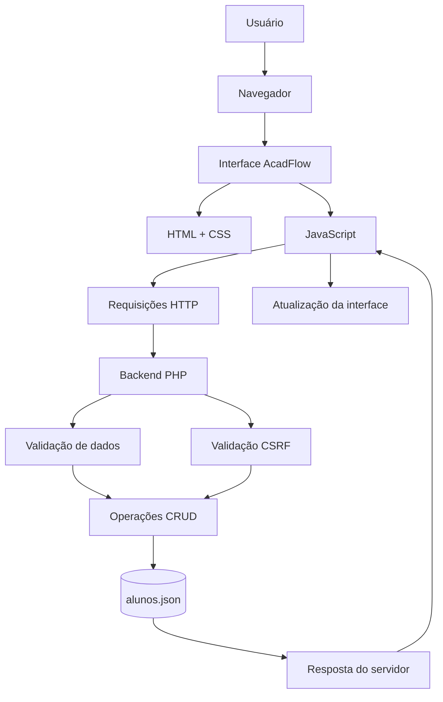
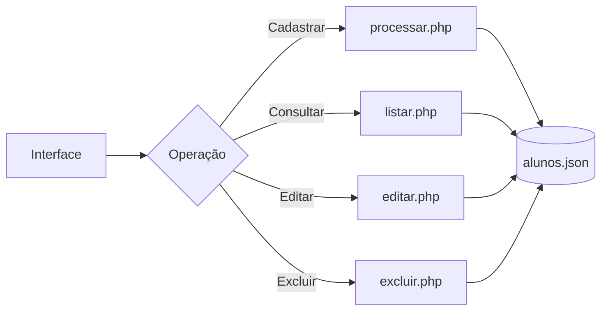

<div align="center">

# 🎓 AcadFlow

### Sistema de Gestão Acadêmica

**Gerenciamento de alunos com uma interface moderna, responsiva e organizada.**

Aplicação web desenvolvida com PHP, JavaScript, HTML5 e CSS3, utilizando arquivos JSON para persistência de dados.


**Desenvolvido por Pedro Toni Melo Giffoni**

</div>

---

## 📑 Sumário

1. [Sobre o projeto](#-sobre-o-projeto)
2. [Funcionalidades](#-funcionalidades)
3. [Tecnologias utilizadas](#-tecnologias-utilizadas)
4. [Arquitetura](#-arquitetura)
5. [Estrutura de arquivos](#-estrutura-de-arquivos)
6. [Instalação e execução](#-instalação-e-execução)
7. [Como utilizar](#-como-utilizar)
8. [Modelo de dados](#-modelo-de-dados)
9. [Segurança](#-segurança)
10. [Identidade visual](#-identidade-visual)
11. [Testes funcionais](#-testes-funcionais)
12. [Compatibilidade com Node.js](#-compatibilidade-com-nodejs)
13. [Limitações conhecidas](#-limitações-conhecidas)
14. [Melhorias futuras](#-melhorias-futuras)
15. [Aprendizados](#-aprendizados)
16. [Autor](#-autor)

---

## 💡 Sobre o projeto

O **AcadFlow** é uma aplicação web para gerenciamento de registros acadêmicos.

O projeto foi desenvolvido para aplicar conceitos de engenharia de software por meio de um sistema funcional, integrando interface gráfica, processamento de requisições, validação de dados e persistência de informações.

A aplicação permite realizar operações CRUD sobre registros de alunos e oferece um dashboard para acompanhar os dados cadastrados.

### Problema abordado

O gerenciamento manual de informações acadêmicas pode dificultar a organização, a consulta e a atualização de registros.

O AcadFlow apresenta uma solução simplificada para centralizar essas operações em uma interface administrativa.

### Objetivo

Desenvolver uma aplicação que permita:

- Centralizar informações de alunos.
- Realizar operações de cadastro, consulta, edição e exclusão.
- Evitar matrículas duplicadas.
- Facilitar a localização de registros.
- Apresentar indicadores acadêmicos.
- Demonstrar a integração entre frontend e backend.
- Aplicar conceitos básicos de segurança e persistência.

### Público-alvo

O projeto foi concebido como uma solução didática para gerenciamento acadêmico, podendo servir de base para sistemas administrativos educacionais.

---

## ✨ Funcionalidades

### 📊 Dashboard administrativo

O painel principal apresenta indicadores calculados a partir dos registros disponíveis.

| Indicador           | Descrição                                        |
| ------------------- | ------------------------------------------------ |
| Total de alunos     | Quantidade de alunos cadastrados                 |
| Total de cursos     | Quantidade de cursos representados nos registros |
| Total de matrículas | Quantidade de matrículas cadastradas             |

O dashboard também disponibiliza uma visualização tabular dos alunos.

### 👨‍🎓 Cadastro de alunos

Permite registrar novos alunos informando:

- Nome completo.
- Número de matrícula.
- Curso.

O backend realiza validações antes de armazenar os dados.

### 📋 Listagem

Apresenta os registros cadastrados em uma tabela organizada.

As informações são obtidas por meio do backend PHP, que realiza a leitura do arquivo JSON.

### ✏️ Edição

Permite atualizar informações de alunos existentes.

Durante a atualização, o sistema:

- Identifica o registro pelo ID.
- Valida os dados recebidos.
- Verifica possíveis matrículas duplicadas.
- Preserva o identificador original.
- Mantém a data de criação.
- Registra a data da atualização.

### 🗑️ Exclusão

Permite remover alunos cadastrados.

A operação utiliza uma requisição POST validada pelo backend.

### 🔎 Pesquisa e filtros

A interface oferece:

- Campo de pesquisa de alunos.
- Filtro por curso.
- Atualização da listagem conforme os critérios selecionados.

### 🌓 Temas claro e escuro

O sistema permite alternar entre duas apresentações visuais.

A preferência é armazenada no navegador utilizando `localStorage`.

### 📱 Responsividade

O layout utiliza CSS responsivo para adaptar a interface a diferentes resoluções de tela.

---

## 🧰 Tecnologias utilizadas

### Frontend

| Tecnologia | Responsabilidade                           |
| ---------- | ------------------------------------------ |
| HTML5      | Estrutura da interface                     |
| CSS3       | Estilização, layout e animações            |
| JavaScript | Interatividade e comunicação com o backend |

O JavaScript é utilizado diretamente no navegador, sem dependência de frameworks frontend.

### Backend

| Tecnologia  | Responsabilidade                      |
| ----------- | ------------------------------------- |
| PHP         | Processamento das operações CRUD      |
| Sessões PHP | Gerenciamento de sessão e tokens CSRF |
| JSON        | Armazenamento dos registros           |

### Ambiente de desenvolvimento

| Ferramenta         | Utilização                      |
| ------------------ | ------------------------------- |
| XAMPP              | Ambiente local com Apache e PHP |
| Apache             | Servidor HTTP                   |
| Visual Studio Code | Edição do código                |
| Navegador web      | Execução da interface           |

> **Nota:** Node.js não é necessário para executar o backend do AcadFlow.

---

## 🏗️ Arquitetura

O AcadFlow utiliza uma arquitetura web simples, organizada em três responsabilidades principais:

**Apresentação → Processamento → Persistência**

### Diagrama da aplicação



### Organização das responsabilidades

**Camada de apresentação**

Responsável pela interface e interação com o usuário.

Arquivos principais:

- `index.php`
- `assets/css/style.css`
- `assets/js/script.js`

**Camada de processamento**

Responsável pelas operações, validações e respostas do servidor.

Arquivos:

- `processar.php`
- `listar.php`
- `editar.php`
- `excluir.php`
- `seguranca.php`

**Camada de persistência**

Responsável pelo armazenamento dos registros.

Arquivo:

- `dados/alunos.json`

### Fluxo CRUD



---

## 📁 Estrutura de arquivos

```text
acadflow/
│
├── index.php
├── processar.php
├── listar.php
├── editar.php
├── excluir.php
├── seguranca.php
│
├── assets/
│   ├── css/
│   │   └── style.css
│   │
│   └── js/
│       └── script.js
│
├── dados/
│   ├── alunos.json
│   └── .htaccess
│
└── README.md
```

### Responsabilidades

| Arquivo         | Função                                        |
| --------------- | --------------------------------------------- |
| `index.php`     | Interface principal                           |
| `processar.php` | Cadastro de alunos                            |
| `listar.php`    | Consulta dos registros                        |
| `editar.php`    | Atualização de alunos                         |
| `excluir.php`   | Exclusão de alunos                            |
| `seguranca.php` | Sessões e proteção CSRF                       |
| `style.css`     | Identidade visual                             |
| `script.js`     | Interatividade                                |
| `alunos.json`   | Persistência                                  |
| `.htaccess`     | Proteção HTTP do diretório de dados no Apache |

---

## ⚙️ Instalação e execução

### Pré-requisitos

Para executar o projeto, são necessários:

- PHP 8.1 ou superior.
- Servidor HTTP com suporte a PHP.
- Navegador atualizado.
- Permissão de leitura e escrita no arquivo de dados.

**Ambiente recomendado: XAMPP.**

### 1. Instalar o XAMPP

Instale o XAMPP utilizando a distribuição oficial do Apache Friends.

### 2. Copiar o projeto

No Windows, localize:

```text
C:\xampp\htdocs\
```

Copie a pasta completa do AcadFlow para esse diretório.

O caminho esperado será:

```text
C:\xampp\htdocs\acadflow\
```

### 3. Verificar o armazenamento

Confirme a existência do arquivo:

```text
dados/alunos.json
```

Para iniciar o projeto sem registros, utilize:

```json
[]
```

> Atenção: substituir o conteúdo de um arquivo JSON existente por `[]` remove os registros anteriormente armazenados.

### 4. Iniciar o Apache

Abra o painel do XAMPP.

Inicie o serviço **Apache**.

### 5. Abrir o sistema

Acesse no navegador:

```text
http://localhost/acadflow/
```

A interface principal deverá ser carregada.

### 6. Verificar o funcionamento

Realize um cadastro de teste e confirme se o registro aparece na listagem.

Depois, atualize a página para verificar se o registro permanece armazenado.

---

## 🧭 Como utilizar

### Cadastrar um aluno

1. Abra o AcadFlow.
2. Acesse **Novo Cadastro**.
3. Preencha o nome.
4. Informe a matrícula.
5. Selecione o curso.
6. Clique no botão de salvar.

### Consultar registros

1. Acesse **Alunos**.
2. Visualize a tabela.
3. Utilize a pesquisa ou o filtro por curso.

### Editar um aluno

1. Localize o registro.
2. Clique em **Editar**.
3. Modifique as informações desejadas.
4. Salve as alterações.

### Excluir um aluno

1. Localize o registro.
2. Clique em **Excluir**.
3. Confirme a operação quando solicitado pela interface.

### Alternar o tema

Utilize o botão de alternância visual no cabeçalho da aplicação.

A preferência selecionada é armazenada no navegador.

---

## 🗃️ Modelo de dados

O armazenamento utiliza uma lista de objetos JSON.

### Exemplo de registro

```json
[
  {
    "id": "a1b2c3d4e5f60718293a4b5c6d7e8f90",
    "nome": "Maria Oliveira",
    "matricula": "20260001",
    "curso": "ADS",
    "criado_em": "2026-11-23 10:00:00",
    "atualizado_em": "2026-11-23 10:30:00"
  }
]
```

_Exemplo ilustrativo da estrutura dos dados._

### Dicionário de dados

| Campo           | Tipo   | Descrição           |
| --------------- | ------ | ------------------- |
| `id`            | String | Identificador único |
| `nome`          | String | Nome do aluno       |
| `matricula`     | String | Número de matrícula |
| `curso`         | String | Código do curso     |
| `criado_em`     | String | Data de criação     |
| `atualizado_em` | String | Data da atualização |

### Cursos permitidos

| Código | Curso                                 |
| ------ | ------------------------------------- |
| ADS    | Análise e Desenvolvimento de Sistemas |
| SI     | Sistemas de Informação                |
| CC     | Ciência da Computação                 |
| ES     | Engenharia de Software                |

### Regras de validação

No processo de edição, o backend verifica:

- Identificador hexadecimal com 32 caracteres.
- Campos obrigatórios preenchidos.
- Nome com até 120 caracteres.
- Matrícula numérica de até 20 dígitos.
- Curso pertencente à lista permitida.
- Ausência de matrícula duplicada em outro registro.

---

## 🔐 Segurança

O AcadFlow incorpora mecanismos básicos de proteção.

### Proteção CSRF

As operações que modificam registros utilizam validação de token CSRF.

Esse mecanismo ajuda a impedir requisições indevidas realizadas a partir de outros sites.

### Validação no servidor

O PHP valida os dados recebidos antes de executar operações de gravação.

A validação no backend é necessária porque verificações realizadas apenas no navegador podem ser contornadas.

### Método HTTP

As operações de alteração de dados exigem requisições POST.

### Controle de concorrência

O backend utiliza `flock()` para bloquear o arquivo durante operações de escrita.

O objetivo é evitar conflitos entre gravações simultâneas.

### Tratamento de exceções

O sistema utiliza tratamento de erros para evitar que falhas internas sejam apresentadas diretamente ao usuário.

### Proteção do armazenamento

O diretório `dados` possui um arquivo `.htaccess` destinado a restringir o acesso HTTP direto quando executado em um Apache configurado para aplicar essas regras.

> [!WARNING]
> O arquivo `.htaccess` não protege automaticamente os dados quando a aplicação é executada em outros servidores, incluindo o servidor embutido do PHP.

### Considerações

Os mecanismos implementados são compatíveis com os objetivos didáticos do projeto.

O sistema ainda não possui autenticação de usuários ou controle de permissões e não deve ser publicado na internet sem uma revisão adicional de segurança.

---

## 🎨 Identidade visual

O AcadFlow utiliza a identidade visual **V4**, baseada em uma combinação de cores escuras, tons neutros e detalhes de alto contraste.

### Paleta oficial

| Cor            | Código    | Proporção de referência |
| -------------- | --------- | ----------------------- |
| Midnight Slate | `#1E2227` | 60%                     |
| Warm Titanium  | `#B5AFA6` | 30%                     |
| Ultra Lime     | `#C8FF1F` | 10%                     |

### Aplicação

**Midnight Slate**

Utilizado em fundos, elementos estruturais e componentes de navegação.

**Warm Titanium**

Utilizado em elementos secundários, textos e superfícies complementares.

**Ultra Lime**

Utilizado em botões principais, seleções e indicadores de destaque.

### Tipografia

A interface utiliza:

- DM Sans.
- Inter.

### Princípios de design

- Hierarquia visual.
- Organização dos componentes.
- Contraste entre elementos.
- Navegação intuitiva.
- Responsividade.
- Animações discretas.
- Consistência visual.

### Capturas de tela

As capturas reais da aplicação poderão ser adicionadas após a conclusão dos testes.

Sugestão de organização:

```text
docs/
└── images/
    ├── dashboard-dark.png
    ├── dashboard-light.png
    ├── alunos.png
    └── cadastro.png
```

Esses arquivos ainda precisam ser criados a partir de capturas reais do sistema.

---

## 🧪 Testes funcionais

O AcadFlow possui um conjunto de cenários de validação funcional.

### Plano de testes

| ID  | Cenário                       | Resultado esperado        | Situação                |
| --- | ----------------------------- | ------------------------- | ----------------------- |
| T01 | Cadastrar aluno válido        | Registro salvo            | Pendente de confirmação |
| T02 | Cadastrar matrícula duplicada | Operação rejeitada        | Pendente de confirmação |
| T03 | Enviar campos vazios          | Validação apresentada     | Pendente de confirmação |
| T04 | Consultar alunos              | Listagem carregada        | Pendente de confirmação |
| T05 | Editar aluno                  | Registro atualizado       | Pendente de confirmação |
| T06 | Excluir aluno                 | Registro removido         | Pendente de confirmação |
| T07 | Pesquisar aluno               | Resultados filtrados      | Pendente de confirmação |
| T08 | Filtrar por curso             | Registros correspondentes | Pendente de confirmação |
| T09 | Atualizar a página            | Dados preservados         | Pendente de confirmação |
| T10 | Alternar tema                 | Interface atualizada      | Pendente de confirmação |
| T11 | Enviar token CSRF inválido    | Requisição rejeitada      | Pendente de confirmação |

### Estratégia de validação

Os testes devem ser realizados em ambiente PHP configurado corretamente.

Para cada cenário, recomenda-se registrar:

1. Condição inicial.
2. Dados utilizados.
3. Ação executada.
4. Resultado esperado.
5. Resultado obtido.
6. Situação final.

> [!NOTE]
> A tabela representa o plano de testes. Ela não constitui evidência de aprovação automática.

---

## ⚠️ Compatibilidade com Node.js

O AcadFlow utiliza JavaScript no frontend, mas seu backend foi desenvolvido em PHP.

Portanto, **não é uma aplicação Node.js**.

### Erro identificado na plataforma acadêmica

Ao tentar executar um arquivo PHP em um ambiente configurado para Node.js, pode ocorrer:

```text
/box/editar.php:1
<?php
^

SyntaxError: Unexpected token '<'
```

Esse erro ocorre porque o Node.js tenta interpretar a sintaxe PHP como JavaScript.

### Causa

O interpretador utilizado não corresponde à linguagem do arquivo.

### Solução

Executar o projeto em um ambiente com suporte a PHP.

As alternativas incluem:

- Apache com PHP.
- XAMPP.
- Outro servidor PHP devidamente configurado.

### Servidor embutido do PHP

Para desenvolvimento local, o PHP disponibiliza um servidor HTTP embutido.

Na pasta do projeto:

```bash
php -S localhost:8000
```

Depois, acesse:

```text
http://localhost:8000
```

> [!CAUTION]
> O servidor embutido do PHP não aplica as regras do `.htaccess`. Não exponha o diretório `dados` publicamente nessa configuração. Utilize esse recurso apenas em um ambiente de desenvolvimento controlado.

### Plataformas acadêmicas

Caso a plataforma disponibilize somente Node.js, será necessário verificar se existe suporte à instalação ou execução de PHP.

A simples alteração da extensão dos arquivos não resolve a incompatibilidade.

---

## 🚧 Limitações conhecidas

O AcadFlow foi desenvolvido com foco acadêmico e apresenta limitações relacionadas ao escopo da implementação.

### Persistência em JSON

O armazenamento em arquivo simplifica o projeto, mas não oferece os mesmos recursos de um banco de dados relacional.

### Gravação dos registros

As operações de atualização utilizam gravação direta no arquivo JSON.

Uma falha durante a escrita pode comprometer o conteúdo armazenado.

Para evolução do projeto, recomenda-se implementar gravação atômica ou utilizar um banco de dados.

### Ausência de autenticação

O sistema não possui controle de login e permissões.

### Escalabilidade

O armazenamento em arquivo não é recomendado para aplicações com grande volume de registros e operações simultâneas.

### Compatibilidade

O backend exige um ambiente capaz de executar PHP.

### Testes automatizados

Ainda não foi documentada uma suíte automatizada de testes para o projeto.

---

## 📈 Melhorias futuras

As próximas versões poderão incluir:

- Banco de dados MySQL ou PostgreSQL.
- Autenticação de usuários.
- Controle de permissões.
- Cadastro de professores.
- Gestão de disciplinas.
- Matrículas por período letivo.
- Exportação de relatórios.
- Gráficos interativos.
- API REST.
- Testes automatizados.
- Histórico de alterações.
- Backups.
- Implantação em servidor PHP.

Esses itens representam possibilidades de evolução e não funcionalidades já implementadas.

---

## 📚 Aprendizados

O desenvolvimento do AcadFlow permitiu aplicar conceitos de engenharia de software na construção de uma aplicação web integrada.

Entre os conhecimentos trabalhados estão:

**Frontend:** construção de interfaces com HTML, CSS e JavaScript.

**Backend:** processamento de requisições HTTP e implementação de regras de negócio utilizando PHP.

**Persistência:** leitura, manipulação e gravação de informações em arquivos JSON.

**CRUD:** implementação das operações fundamentais de gerenciamento de registros.

**Segurança:** validação de dados, proteção CSRF e controle de acesso aos arquivos.

**Arquitetura:** organização do código por responsabilidades.

**Usabilidade:** construção de uma interface responsiva, com navegação, indicadores e recursos de pesquisa.

**Ambiente de execução:** compreensão das diferenças entre JavaScript no navegador, Node.js e PHP executado no servidor.

O projeto demonstra a importância de integrar diferentes tecnologias de maneira organizada, considerando funcionalidades, experiência do usuário, manutenção e segurança.

---

## 👨‍💻 Autor

**Pedro Toni Melo Giffoni**

Estudante de Análise e Desenvolvimento de Sistemas, com atuação em desenvolvimento de soluções inteligentes, automação e inteligência artificial.

**Projeto:** AcadFlow — Sistema de Gestão Acadêmica  
**Categoria:** Desenvolvimento web / Engenharia de Software  
**Finalidade:** Acadêmica e educacional

**GitHub:** [PedroGiffoni](https://github.com/PedroGiffoni)

---

## 📄 Licença

Este projeto foi desenvolvido para fins acadêmicos.

Nenhuma licença de software específica foi definida nesta documentação.

---

<div align="center">

### 🎓 AcadFlow

**Organização acadêmica, tecnologia e simplicidade.**

Desenvolvido com PHP, JavaScript, HTML5, CSS3 e JSON.

</div>
